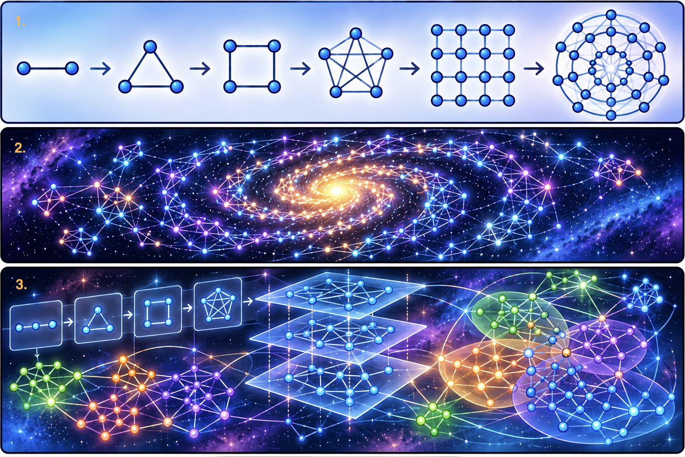
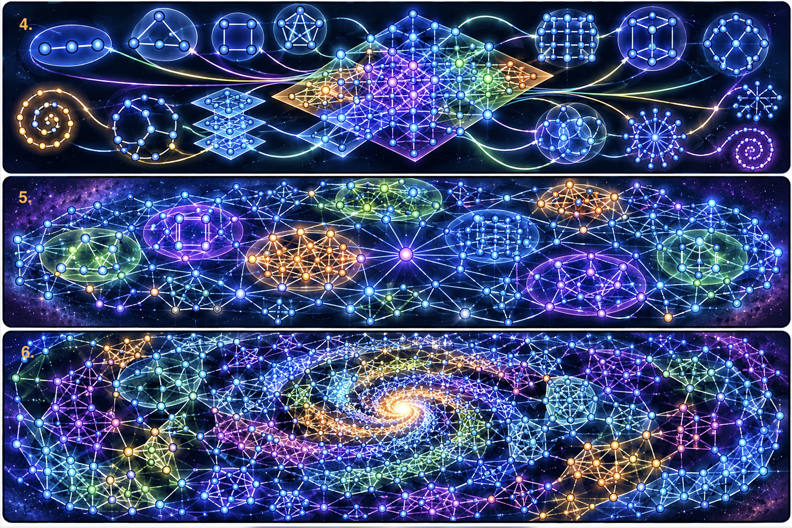
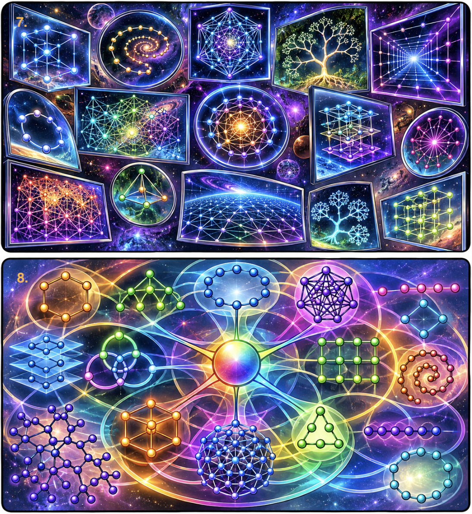
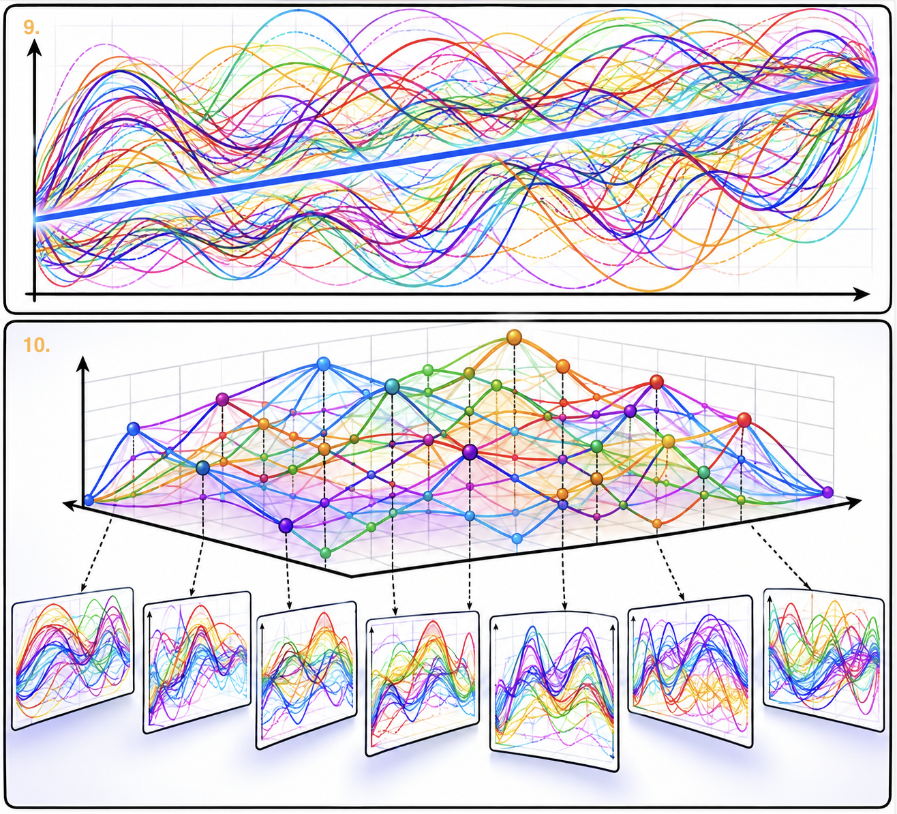

# Graph Visuals

Here are some visuals of simple variants of example relevant graphs that are useful to identify and apply.

1. The first graph indicates a simple visual of a 'graph sequence of increasing complexity', which is useful to think about as a guide for future graphs. It's useful to identify 'current graphs' as 'being unnecessarily complicated', where more optimal variants of complex current graphs have more trivially identifiable patterns in the complexity.

2. The second graph indicates a simple visual of the 'optimal graph of graphs', which involves a useful integration of many different relevant graphs, capturing all the possible relevant variation of reality.

3. The third graph indicates a simple visual of 'graph applications and other graph structures', which could create a 'graph optimization sequence that can optimize any universe', for example.

4. The fourth graph indicates a simple visual of a 'graph representing an application of interface analysis', which when applied, connects every relevant graph optimally.

5. The fifth graph indicates a simple visual of a graph of 'complexity graph structures', like 'graphs embedded in a base graph', which gives a hint of how complex graphs can become with trivial changes.

6. The sixth graph indicates a simple visual of a graph of a 'high ratio of solution/problem complexity/variation', where outer solution structures are more complex than the relatively organized/simple problem structures, which is a useful graph to aim for when optimizing problem-solving.

7. The seventh graph indicates a simple visual of a 'graph of different perspectives' ('perspectives' defined as 'different filters of reality, like different priority sets/sequences/graphs/structures').

8. The eighth graph indicates a simple visual of a 'graph of the definition of relevance', with different sub-graphs representing different optimal interactions between relevance components like 'reusability', 'efficiency', and 'independence'.

For an example of how to solve problems with graphs (in this case, by 'increasing the dimensionality of a graph'), see the below graphs 9 and 10.

9. Graph 9 indicates a simple visual of an 'evil perspective' (where 'virtue' is a simple/boring line, and 'evil' is 'everything else, representing higher variation/complexity').

10. Graph 10 indicates a simple visual of a higher dimensional graph, a 'graph of perspective graphs', where points are connected to a lower graph layer representing different perspective graphs, in which the 'evil' perspective is just one point in this graph (indicating that 'evil' is the simple/boring structure, and every other perspective, other perspectives implementing virtues like 'stability/multi-functionality/independence' as a 'component of reality/relevance', is higher variation/complexity than the 'evil' graph).

The 'more optimal graph' in this set is the more 'relevantly variable/complicated' graph (graph 10) which better reflects reality and more optimally implements the definition of relevance/optimality.

Graph 9 is why criminals have an 'incorrect sense that its higher variation/complexity to be evil than to be good, which they incorrectly see as "following simple rules"', when in reality, using Graph 10, it's trivial to 'identify who is a criminal by their intelligence/complexity/variation level' and trivial to 'identify that criminals always do the same thing, bc they all have the same sense of the same graph/perspective' (the 'work-minimization graph, identifying the "easy cruel" action, which they can trivially identify, which they think they can trivially get away with').

